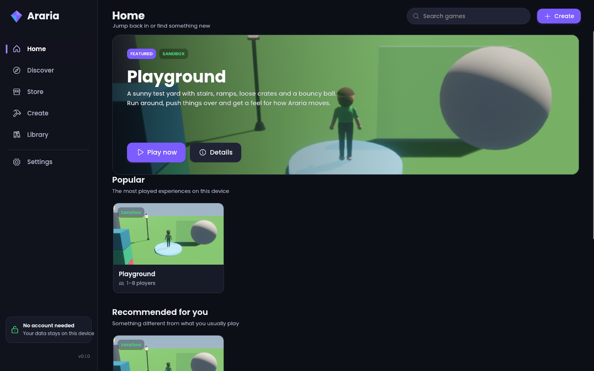
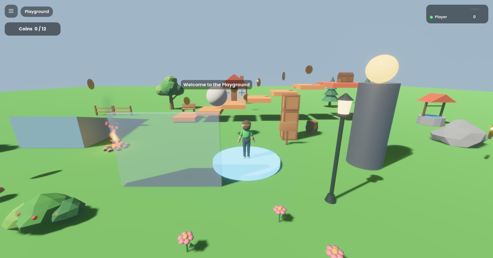

<div align="center">

# Araria

<p align=center>
    <sub>A 3D game platform and creation studio that runs in your browser, no account needed!</sub>
    <br />
    <sub>Heavily inspired by Roblox and Roblox Studio!</sub>
</p>

[](https://www.rust-lang.org/)
[](https://webassembly.org/)
[](Cargo.toml)


[](https://stand-with-ukraine.pp.ua)

</div>

---
> [!NOTE]
> **Araria is still under active development!** More features are to come.


## Features:

- A complete 3D engine built on Bevy:
- - Physics, a character controller, rigged and animated characters, audio and particles.
- - A library of 42 low-poly models and 33 sound effects made with the included Blender and audio pipelines.
- Lua scripting with a Roblox-style API!
- - Our own Lua 5.4-style virtual machine, written in Rust.
- - Events, tweens, on-screen GUI, saved progress and live hot reloading.
- Araria Studio, a game development environment built into the app:
- - A 3D editor with move, rotate and scale tools, an explorer, a properties inspector and an asset browser.
- - A Lua code editor with highlighting, autocomplete and error markers, plus a terminal connected to the running game.
- A platform shell with Home, Discover, Store, Create, Library and Settings screens, all stored locally.


## Live Demo

---
> [!WARNING]
> The live demonstration is not a main priority, and therefore is not obligated to stay up to date with the repository.
> It is encouraged for you to clone the repository and host it yourself to play with your friends!

A live demo of the project can be found [here](https://gurmehar-singh-2009.github.io/araria-/).


## Performance

The release WebAssembly build (`trunk build --release`) is about 40 MB of `.wasm` before compression, plus 3.4 MB of assets.
Graphics quality, shadows, bloom, anti-aliasing and view distance can be lowered in Settings for slower devices.


## Getting Started

You will need the following installed:
- Rust (the nightly toolchain and the `wasm32-unknown-unknown` target are picked up from `rust-toolchain.toml`)
- Trunk

To install trunk:
```bash
cargo install trunk
```

Then you can run
```bash
# in the browser, at http://127.0.0.1:8080
trunk serve

# or as a desktop app
cargo run --release
```
if you are playing locally, otherwise use `trunk build --release` and host the `dist` folder.


## Crates Usage

I will refrain from importing unnecessary crates, or crates that I feel like I could replicate and improve functionality on (for example, the Lua virtual machine is written from scratch instead of binding to C Lua). However, crates will be imported when:
- They are practically necessary for development (Bevy, egui, Rapier).
- It will take too much time/effort to write myself.
- Writing it myself is not considered worth it.


## Note on Cryptography

Araria does not use any cryptography at the moment. There are no accounts or servers: games, projects, settings and saves are stored locally on your device.
Multiplayer has not been implemented yet; how its connections will be secured will be documented here once it is.


## Unique Features

- Araria Studio is part of the app itself. Edit a game, press Play to run it in place, and Stop to return to exactly what you had before playing.
- Live hot reloading. Saving a script while the game runs reloads only that script, keeping the rest of the game and each script's `state` intact.
- No accounts. Everything works offline, and projects can be exported and imported as single `.araria` files.


## Why use Rust? Why not write in JS/TS, or something else like that?

One codebase builds for both the browser (WebAssembly) and the desktop, and Rust compiles to fast WebAssembly with no garbage collector pausing the game.

Its type system also catches whole classes of bugs at compile time. That matters in a project like this one, where the engine, the scripting VM and the editor all share the same data model.


## Contribution Guidelines

I will not be accepting any feature contributions. Only contributions that refactor existing code with clear, listed out benefits. Final decisions will be made by me solely on what code is accepted, and I reserve the right to use my own discretion regardless.


## AI Usage

AI was used extensively in this project. Most of the code, assets, tests and documentation were written with Claude Code (Anthropic's AI coding agent), directed and reviewed by me.

The commit history shows how the project was built up, one milestone at a time.

# Screenshots
## Homescreen


## In game


